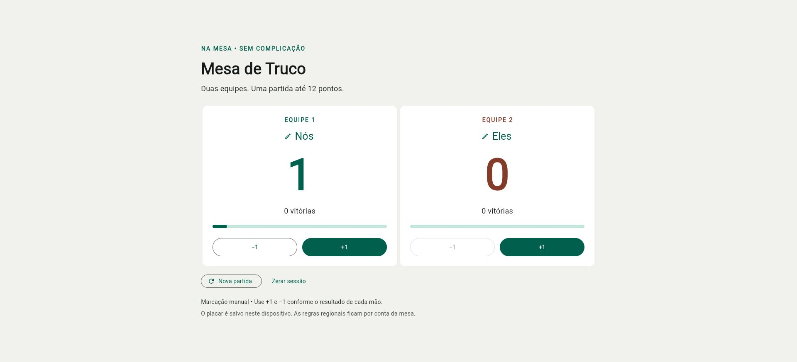

# Mesa de Truco · Truco Scoreboard

[](https://github.com/kleberandrade/marcador-truco-aulas-flutter/actions/workflows/flutter.yml)


[](LICENSE)

An offline two-team scoreboard, originally created by Kleber de Oliveira Andrade for mobile programming classes. Portuguese interface, modern Flutter, no account or backend required.

## Run

Verified with Flutter **3.50.0**, bundled Dart **3.14.0**, and Chrome on macOS. Do not use the original Dart 2 toolchain.

```sh
flutter pub get
flutter run -d chrome
```

## Play

- Tap a team name to rename it (1–24 trimmed characters).
- Use +1 / −1 for manual scoring, bounded to 0–12.
- At 12, confirm the victory: the winner gains one victory and both scores reset. Cancel returns the winner to 11. The confirmation cannot be dismissed by tapping outside or pressing Back.
- New match resets points while keeping names and victories. Reset session clears points and victories after confirmation.
- Names, points, victories and pending winner confirmation resume from this browser/device. Save errors are visible and offer retry. Browser storage can be cleared by the browser and is not a backup.
- At 11–11 the interface reminds players to agree on iron-hand rules.

This preserves the original tutorial's manual twelve-point game. It does **not** enforce Paulista, Mineiro or other regional card rules, bidding, hands, or online play. Add the agreed hand value by tapping +1 repeatedly. Always-on screen behavior remains an exercise.

Try a match locally: rename teams to Amigos/Visitantes, give them points, reload and check recovery. `docs/example-match.json` is a versioned fixture (11–8, 2–1 victories), usable with `Match.decode`; there is no import UI.

## Architecture and migration

`lib/domain/match.dart` owns immutable validated state and pure transitions. `lib/data/match_store.dart` isolates local storage. `TeamBoard` renders reusable team cards. `HomePage` owns interaction and serializes saves by disabling controls during writes; Material controls support keyboard focus and accessible semantics. Layout stacks cards on narrow screens and uses two columns from 650 logical pixels. Loading, invalid-save and save-error states are explicit.

Original code stored everything in memory, so there are no persisted legacy records to migrate. New records use `truco.match.v1`, a single JSON snapshot with schema version 1. Unknown versions and malformed values are rejected without overwriting until a user explicitly saves/starts playing. Future schema changes must migrate this key and retain compatibility tests.

Android build files follow Flutter 3.50.0 templates; the iOS scaffold was migrated from the original Flutter 3.41 modernization, preserving the original `com.example.marcador_truco` application identity and launcher assets. These are classroom development identifiers; release signing is not configured. The MIT license and original authorship remain unchanged.

## Verification

```sh
dart format --output=none --set-exit-if-changed lib test
flutter analyze
flutter test --coverage
flutter build web --no-wasm-dry-run
flutter build ios --simulator --debug
flutter test integration_test/scoreboard_test.dart -d YOUR_SIMULATOR_ID
```

Seven local tests cover score boundaries, winner lock/cancel/confirm, resets, name validation, serialized round trips, persistence recovery, corrupt-save preservation and widget interactions. The published GitHub workflow in `.github/workflows/flutter.yml` runs analysis/tests/Web builds. Its live badge reflects GitHub status.

Web build and Chrome preview were exercised locally. Some Android licenses remain incomplete; the debug APK compiled without accepting new terms. Android debug APK compiled with the updated Gradle template; Android interaction and physical devices were not validated. iOS simulator packaging and one native integration test passed on an iPhone 17 Pro / iOS 26.4.1. Xcode 27's lipo rejects Flutter's multi-architecture check; `ios/Flutter/Debug.xcconfig` selects arm64 for simulator Debug only. Explicit arm64 avoids arm64e reported by an Xcode host process. Intel Macs need x86_64 instead (unverified); device and Release architecture settings are unchanged. Xcode 27.2, Flutter failed to package its simulator engine with an architecture check despite lipo listing both architectures. This is an unresolved local toolchain limitation, not a successful native build. Xcode 27.2 and Android SDK 36.1.0 were detected. `crapper`, `dryer`, and `mutator` are installed but their supported language lists exclude Dart; no CRAP, duplication or mutation score is claimed.



## Original lesson

[Creating a Truco scoreboard in Flutter (Portuguese)](https://medium.com/flutter-comunidade-br/criando-um-marcador-de-truco-em-flutter-e50669f21f03), by Kleber Andrade (2019), originally linked via http://bit.ly/2MDO6ww. The modernized code implements the lesson's boundary, restart, modal confirmation and rename exercises. The updated lesson and new cover were published at the original URL, with real Web/iOS captures. See [didactic article source](docs/medium-update.pt-BR.md) and [work log](docs/WORK_LOG.md).

## License

[MIT](LICENSE), Copyright 2019 Kleber de Oliveira Andrade. Flutter and platform-generated resources retain their respective licenses. No third-party article text or artwork is bundled.

The native integration test owns only the scoreboard key on a disposable test simulator. It exercises renaming, cancellation/confirmation of victory, reset preserving victories and reloading native storage. Packages were rechecked and updated with the new SDK; see the dependency maintenance section for the two tested SDK-pin overrides.

## Keeping dependencies current

App 2.1.0+3 uses Flutter 3.50.0 / Dart 3.14.0, pinned in `.fvmrc` and CI. Select this SDK before running the commands; `.fvmrc` alone does not change your shell. The system Flutter installation was not upgraded. Material imports now use `material_ui` 1.11.1. All packages, including transitives, match the latest versions reported by `flutter pub outdated` on 2026-11-17.

Two exact overrides (`material_color_utilities` 0.13.1 and `test_api` 0.7.15) supersede SDK pins only after local analysis, seven tests, native integration, Web/iOS simulator/Android debug builds passed. Compare `flutter pub outdated --no-dependency-overrides` to inspect the upstream restrictions. Re-test the overrides at each SDK change; remove them once no longer needed. Keep the lockfile.

```sh
flutter pub outdated
flutter pub upgrade --major-versions
flutter analyze
flutter test
flutter build web --no-wasm-dry-run
flutter build ios --simulator --debug
flutter test integration_test/scoreboard_test.dart -d YOUR_SIMULATOR_ID
flutter build apk --debug
```

The Flutter migrator added Swift Package Manager integration while retaining the customized CocoaPods setup. Both build and native integration passed; completing the CocoaPods removal remains separate work.
